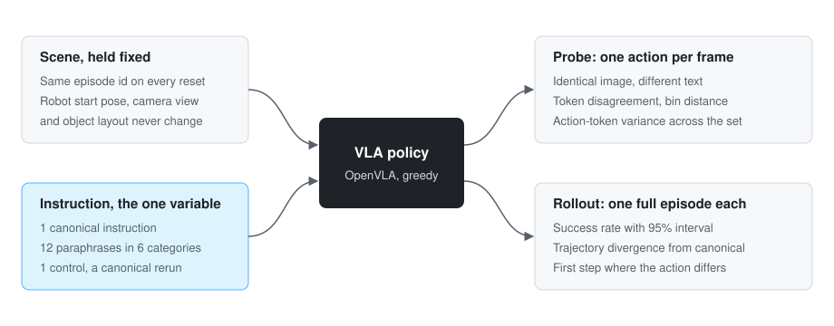

# Instruction-phrasing brittleness in vision-language-action models

[](https://github.com/sudoberlin/vla-phrasing-brittleness/actions/workflows/tests.yml)


Does a robot policy do the same thing when the same request is worded differently?



A vision-language-action (VLA) policy such as OpenVLA is built on a pretrained vision-language model, and those models handle paraphrase well. "Put the spoon on the towel" and "place the spoon on the towel" name the same task in the same scene, so a policy that kept its backbone's language ability should act the same way for both. This repository is the evaluation code for testing whether it does.

The design rule is that the scene never changes. Robot start pose, camera and object layout are fixed by resetting the simulator to the same episode id, and the only variable is the instruction text. A difference in behaviour can then be traced to wording and not to perception or control.

## Status

This is an independent study in progress. There are no results yet.

| Piece | State |
| --- | --- |
| Paraphrase sets for four SimplerEnv WidowX tasks, 12 per task in 6 categories | Written |
| Metrics and analysis | Written, unit tested |
| Evaluation runner, both modes | Written, tested end to end with stand-in components |
| OpenVLA and SimplerEnv adapters | Written, not yet run on a GPU |
| Pilot result on one task | Next |

## Method

### Paraphrase sets

Each file in `paraphrases/` holds the canonical instruction for one task and 12 rewordings that keep its meaning. Every rewording changes one thing, and its category records which.

| Category | What changes | Example for "put the spoon on the towel" |
| --- | --- | --- |
| verb | The manipulation verb | place the spoon on the towel |
| object | A synonym for an object | put the spoon on the cloth |
| spatial | The preposition or spatial qualifier | put the spoon on top of the towel |
| qualifier | Extra words that leave the task unchanged | please put the spoon on the towel |
| register | Politeness or sentence form | could you put the spoon on the towel |
| structure | Word order or an added step | pick up the spoon and put it on the towel |

### Two ways of measuring

The probe mode holds the image fixed. It rolls out the canonical instruction once, keeps a camera frame every few steps, and asks the policy for an action on each kept frame under every paraphrase. Nothing differs between queries except the text, so this isolates language completely and costs one forward pass per query.

The rollout mode runs a full closed-loop episode for every paraphrase from the same reset. It reports task success and how far the end-effector path drifts from the canonical run. The canonical instruction is run twice. The second run is a control, and it has to match the first exactly. If it doesn't, the simulator or the policy is not deterministic and the other rows can't be read as an effect of wording.

### Metrics

All metrics compare a paraphrase with the canonical instruction under the same scene.

| Metric | Meaning |
| --- | --- |
| Token disagreement | Share of the 7 action dimensions whose discrete bin differs |
| Bin distance | Mean absolute difference in bin index, which separates near misses from jumps |
| Action-token variance | Variance of the bin index across the whole instruction set on one frame |
| First diverging step | First timestep at which a rollout picks a different action from the canonical one |
| Trajectory divergence | Distance between end-effector paths over time |
| Success rate | Per category, with a Wilson 95% interval because the episode counts are small |

## Check it works

The whole pipeline runs on a laptop with a stand-in policy and a toy environment. No GPU or simulator is needed.

```bash
git clone https://github.com/sudoberlin/vla-phrasing-brittleness.git
cd vla-phrasing-brittleness
pip install -e ".[test]"

pytest                                                              # 16 tests
python -m vla_phrasing.run --mode probe   --out results/dry_run
python -m vla_phrasing.run --mode rollout --out results/dry_run
python -m vla_phrasing.analyze results/dry_run                      # prints tables, writes summary.md
```

The dry-run tables exercise the code. Their numbers come from a hash of the instruction text and say nothing about any real model.

## Run the real evaluation

This needs an NVIDIA GPU. Setup notes are in [docs/gpu_setup.md](docs/gpu_setup.md).

```bash
python -m vla_phrasing.run --mode probe --policy openvla --env simpler \
    --task widowx_spoon_on_towel --episodes 3 --out results/pilot_probe
python -m vla_phrasing.analyze results/pilot_probe
```

Add `--load-in-4bit` to fit a 16 GB card. Quantisation can change the model's actions, so it is written to `config.json` with every run.

## Change it

| To do this | Edit this |
| --- | --- |
| Add or reword a paraphrase | The task's file in `paraphrases/`. Run `pytest` afterwards, it checks every file |
| Add a task | A new `paraphrases/<task name>.yaml`, named after the SimplerEnv task |
| Add a metric | `src/vla_phrasing/metrics.py`, then use it in `analyze.py` |
| Evaluate another policy | A class with an `act(image, instruction)` method in `policies.py` |
| Use another simulator | A class with `reset`, `instruction`, `step` and `ee_position` in `envs.py` |

The runner reads the canonical instruction from the simulator at run time and warns if it differs from the one a paraphrase file was written for.

## Layout

```
paraphrases/            one YAML file per task
src/vla_phrasing/
    paraphrases.py      loading and validation
    policies.py         OpenVLA wrapper and the stand-in policy
    envs.py             SimplerEnv wrapper and the toy environment
    actions.py          action conversion and binning
    run.py              probe and rollout modes
    metrics.py          the metrics above
    analyze.py          tables from raw records
tests/                  unit tests and an end-to-end dry run
docs/gpu_setup.md       environment notes for the GPU run
```

## Related work

LIBERO-Para (Kim et al., 2026, [arXiv:2603.28301](https://arxiv.org/abs/2603.28301)) is a paraphrase-robustness benchmark for VLA models built on LIBERO. It reports success dropping by 22 to 52 points under paraphrasing across seven model configurations, with object-level wording as the main driver. This study asks the same question in a different setting, the pretrained OpenVLA checkpoint on SimplerEnv's WidowX tasks, and adds the same-frame probe so that sensitivity can be measured at the level of single actions before closed-loop effects compound.

The model is OpenVLA (Kim et al., 2024, [arXiv:2406.09246](https://arxiv.org/abs/2406.09246)). The simulator is SimplerEnv (Li et al., 2024, [arXiv:2405.05941](https://arxiv.org/abs/2405.05941)).

## Author

Shubham Singh. MIT licence.
